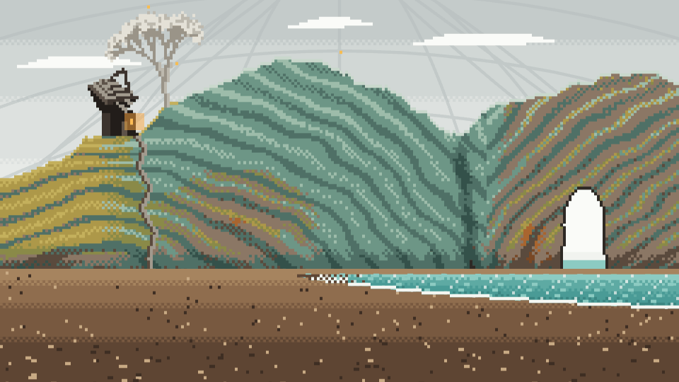
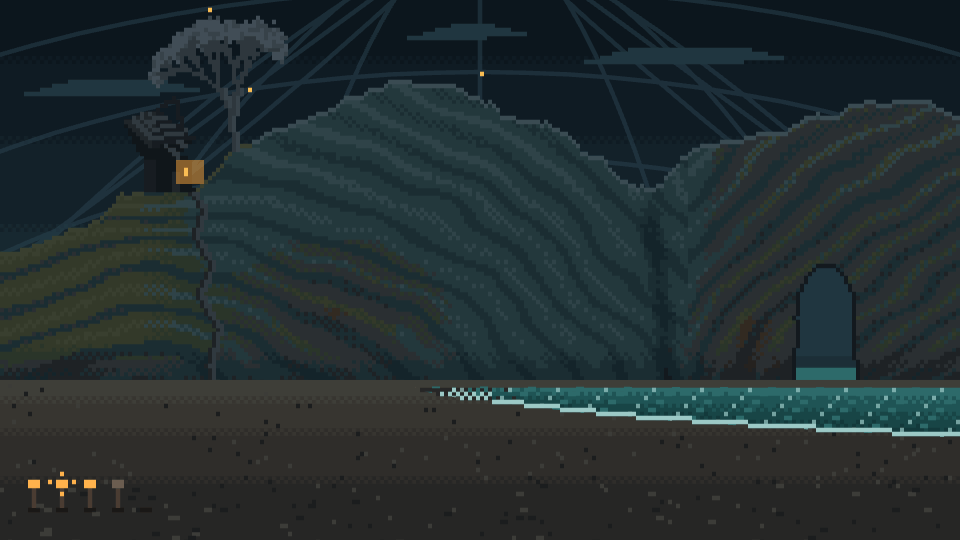
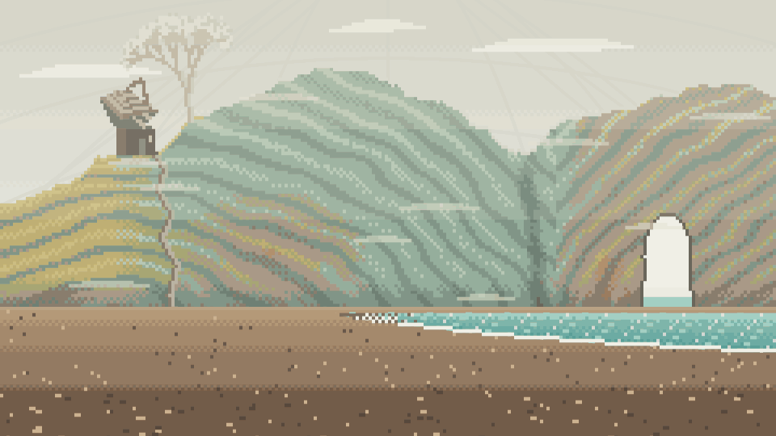

# Erid: Grace's Dome

A Claude Code theme mod inspired by *Project Hail Mary*. It shows Grace's beach inside the dome on Erid, modelled on Durdle Door in Dorset, as an animated pixel-art backdrop with matching app colours. The beach reacts to what Claude is doing.


## Previews

| Day (light mode) | Night (dark mode) |
|---|---|
|  |  |
| **Idle.** Waves, sea sparkle, clouds, swaying tree | **Idle at night.** Rib lamps flicker, the window is lit |
|  |  |
| **Working.** Claude is on a turn: lamps on, window glowing | **Launch.** A subagent starts: a Beetle probe streaks past |
|  |  |
| **Ask.** Claude asks you something: Rocky walks in, waves, sings, stomps | **Amaze.** A turn of a minute or more finishes |
|  |  |
| **Permit.** A permission prompt waits: Rocky holds up "ALLOW, QUESTION?" | **Return.** A subagent finishes: its Beetle comes home |
|  |  |
| **Tasks.** A lamp per task in the bottom-left corner: lit when done, blinking in hand | **Haze.** The dome thickens as the context fills; a compaction blows it away |

Every reaction works in both modes; the GIFs mix them to show both palettes.

## What it does

| When | On the beach |
|---|---|
| Nothing running | Waves wash up the sand, sea sparkle, drifting clouds, the pale tree sways |
| Claude is working on a turn | Dome lamps switch on and Grace's window glows |
| A subagent starts | A Beetle probe streaks across the dome with an amber drive trail |
| Claude starts writing a question | Rocky walks up in his faceted glass suit, waves once, then stands by singing chords. Every ~6 s without an answer he stomps three times |
| The question is answered or dropped | Rocky walks back out |
| A turn of 1 minute or more finishes | Rocky pops in for jazz hands under an "AMAZE!" sign |
| A subagent finishes | Its Beetle drops back down the dome and lands behind the hill |
| A permission prompt waits | Rocky walks up holding an "ALLOW, QUESTION?" sign, stomping now and then, and walks out once it's settled |
| Claude keeps a task list | A marker lamp stands on the sand per task: dark while waiting, blinking while in hand, lit once done. A finished list clears 12 s after the turn ends |
| The context window fills | A haze thickens in the dome, from faint at 35% full to dense past 85% |
| The conversation is compacted | The haze blows away to the right as it thins |

Light mode is the dome by day. Dark mode is the dome at night: deep teal sky, lamps along the ribs, a lit window. Scene changes keep the clouds, waves and lamps in step, so nothing jumps.

### Commands

- `/erid` puts the theme back on, for example after trying another theme.
- `/erid launch`, `/erid return`, `/erid ask`, `/erid permit`, `/erid amaze` and `/erid working` replay one reaction so you can look at it.
- `/erid haze 0-5` sets the haze until the next measurement (a lower level blows it away, as a compaction does), and `/erid tasks` stands four demo lamps on the sand for 15 s.

## Install

This repository is both the mod and a marketplace. From a terminal:

```bash
claude plugin marketplace add mrandika/erid-dome-claude-theme
```
```bash
claude plugin install erid-dome@erid-dome
```

To hack on it, clone the repo and add the folder instead (`claude plugin marketplace add /path/to/erid-dome-claude-theme`), so the plugin is read in place. After editing, run `/reload-plugins`. Only one theme shows at a time: if `hail-mary` is also enabled, the last one set wins, and `/erid` brings this one back.

## Project layout

| Path | Role |
|---|---|
| `.claude-plugin/` | `plugin.json` (the mod) and `marketplace.json` (local install) |
| `hooks/register.tsx` | The stage machine, hooks, `/erid` command and backdrop render |
| `hooks/look.ts` | App colours (`makeColors`) |
| `hooks/overlay.ts` | The live layers drawn into any scene: the haze and the task lamps |
| `hooks/scene.ts` | **Generated** scenes plus the `SYNC` table; don't edit |
| `hooks/*.test.ts(x)` | Tests: the backdrop render, task lamps, haze, permission prompt and Beetle return (`claude plugin test .`) |
| `types/index.d.ts` | The `stage`, `haze` and `tasks` state contract |
| `scene/gen-pixel.mjs` | Draws the beach and writes all eight scenes and `hooks/scene.ts` |
| `scene/rocky.mjs` | Pixel Rocky: poses, glass suit, chords, the AMAZE! and ALLOW, QUESTION? signs, timelines |
| `scene/erid-dome*.svg` | The generated scenes, for previewing in a browser |
| `scene/render-previews.mjs` | Renders the README GIFs in `docs/previews/` |
| `scene/build-probes.mjs` | Diagnostic backdrops for finding animation freezes |
| `docs/` | The full documentation (below) |

### Rebuilding the scenes

```bash
node scene/gen-pixel.mjs
```

It prints each scene's size. Each must stay under **131,072 characters**; the asking scene is the largest, at about 126K.

### Rebuilding the preview GIFs

```bash
npm i --no-save playwright-core && node scene/render-previews.mjs
```

This opens each scene in headless Chromium, pauses its animations and steps the clock at 10 fps, then encodes the frames with ffmpeg (needed on `PATH`). Pass names such as `ask amaze` to redo only some. If Playwright can't find a browser, set `CHROME_PATH`.

## Documentation

| Doc | What's in it |
|---|---|
| [docs/research.md](docs/research.md) | Story, glossary, Erid, Rocky, Durdle Door, the film's look, sources |
| [docs/art-direction.md](docs/art-direction.md) | Composition, the style decision, pixel-art rules, every palette with hex values, Rocky's design rules |
| [docs/scene-reference.md](docs/scene-reference.md) | Generator internals: coordinates, geometry, layers, encoding, night mode, animations, `SYNC`, the six scenes, how to extend |
| [docs/rocky-reference.md](docs/rocky-reference.md) | Sprite model, poses, frame sharing, the ask, leave and amaze timelines |
| [docs/mod-reference.md](docs/mod-reference.md) | Files, installing, the theme call, the stage machine (with diagram), hooks, timers, tunables, validation, ideas |
| [docs/troubleshooting.md](docs/troubleshooting.md) | Animation freeze triggers and the probe method, jumps, missing Rocky, browser previews, size limits, validator messages |
| [docs/changelog.md](docs/changelog.md) | How the theme evolved |

## Rules learned the hard way

- **No `shape-rendering="crispEdges"`.** The desktop app then freezes every animation in the backdrop.
- Avoid aspect-ratio `@media` queries, `transform-box: view-box` and `#id` selectors in scene CSS, which are suspected to cause the same freeze.
- Keep each ambient loop's duration the same in every scene, and list it in `SYNC`.
- A freeze only shows in the app, never in a browser preview.

## Credits

Fan art for personal use, drawn from scratch in pixel art. *Project Hail Mary* is Andy Weir's novel and the 2026 film. Rocky and the Eridians are his creations.
