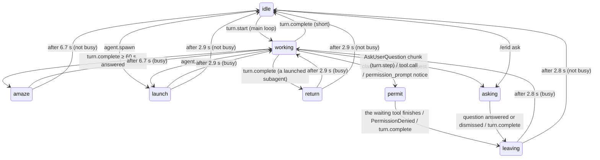

# Mod reference (`erid-dome`)

A Claude Code **function-hooks mod**: TypeScript hooks that the engine loads. It sets the session's theme (colours plus an animated backdrop) and swaps the backdrop as Claude works. It draws only on the **desktop** and **mobile** surfaces; the terminal and editors draw no backdrops.

## Files

| Path | What |
|---|---|
| `.claude-plugin/plugin.json` | Manifest: `name` `erid-dome`, `version`, `description`, and `types: ./types/index.d.ts` |
| `.claude-plugin/marketplace.json` | Makes this repo a marketplace (`erid-dome`) listing the mod at `./` |
| `.claude-plugin/types/` | Written by the engine when it loads the mod: API typings plus `tsconfig.json`. Don't edit |
| `hooks/hooks.json` | `{ "modules": ["./register.tsx"] }` |
| `hooks/register.tsx` | All hooks: theme, stage machine, timers, commands, backdrop render |
| `hooks/look.ts` | App colours from `makeColors` |
| `hooks/make-colors.js` / `.d.ts` | The design system's colour builder, copied from the plugin-authoring skill. Don't edit; re-copy when the build updates |
| `hooks/scene.ts` | **Generated.** `SYNC` plus six scene strings |
| `types/index.d.ts` | State contract: `PluginState['erid-dome'] = { stage: Stage }` |
| `tsconfig.json` | Extends the engine's `.claude-plugin/types/tsconfig.json` |

## Installing and loading

### From GitHub

The repository is its own marketplace. From a terminal:

```bash
claude plugin marketplace add mrandika/erid-dome-claude-theme
```
```bash
claude plugin install erid-dome@erid-dome
```

### From a clone (for development)

Add the cloned folder as the marketplace instead, so it is read in place and edits there are what loads:

```bash
claude plugin marketplace add /path/to/erid-dome-claude-theme
```
```bash
claude plugin install erid-dome@erid-dome
```

After editing, run `/reload-plugins` in a session. A plugin read from its folder is re-read from there; no reinstall is needed.

### Other ways

- **Development from this folder:** `claude --plugin-dir /path/to/erid-dome-claude-theme` for one terminal session. For desktop-app sessions, put the path in `CLAUDE_CODE_PLUGIN_DIRS` in the `env` block of `~/.claude/settings.json`.
- **The session mods folder:** the mod was first built in `~/.claude/dev-mods/<session-id>/erid-dome/`, which only hot-reloads in the session that wrote it.

### One theme at a time

Only one theme stands at a time, and the last plugin to call `$.theme.set` wins. With both `erid-dome` and `hail-mary` enabled, whichever runs `session.start` last takes over. Each has a command to bring its own back: `/erid` and `/hail-mary`. Disable one to keep the other for good.

## The theme

`session.start` calls:

```ts
$.theme.set({ colors: COLORS, backdrop: { scene: 'erid-dome', glass: { blur: 28, opacity: 0.42 } } })
```

- **`glass`** is how the desktop app frosts its panels over the backdrop: a 28 pt blur, 42% opacity, and no `tint`, so each panel keeps its own colour per mode. On mobile it's one veil over the whole scene.
- **No `overrideColorScheme`:** both modes are given, and the scene follows the system's dark mode itself through CSS.
- **If it isn't drawn** (no desktop or mobile surface attached), the reason shows in the status line.

## The stage machine

One state value, `stage`, decides which scene draws:

| Stage | Scene | Meaning |
|---|---|---|
| `idle` | `SCENE` | Nothing running |
| `working` | `SCENE_WORK` | A main-conversation turn is running |
| `launch` | `SCENE_LAUNCH` | A subagent just started; the Beetle flies (passing) |
| `return` | `SCENE_RETURN` | A subagent this load launched just finished; the Beetle lands (passing) |
| `asking` | `SCENE_ASK` | Claude is writing or showing an `AskUserQuestion` |
| `permit` | `SCENE_PERMIT` | A permission prompt is waiting; Rocky holds up "ALLOW, QUESTION?" |
| `leaving` | `SCENE_LEAVE` | Rocky walks out (passing) |
| `amaze` | `SCENE_AMAZE` | A turn of 60 s or more finished (passing) |



### Hooks

| Hook | What it does |
|---|---|
| `session.start` | Resets to `idle`, sets the theme, registers `/erid` |
| `turn.start` | Main loop only (`agentId` absent). Marks busy; switches `idle` to `working`. Doesn't interrupt a passing stage (launch or amaze), and leaves asking and leaving alone |
| `turn.step` | A **streaming** hook (`async function*`). Watches the model's response, and on the first `tool` chunk named `AskUserQuestion` calls `arrive()`. That's before the question dialog opens, so Rocky is already walking while the question is written |
| `tool.call {tool: AskUserQuestion}` | `arrive()`, then `await next(e)`, which lasts until you answer, then `leave()`. It has `.catch(($, e, next) => next(e))`, so a state failure never blocks the question |
| `agent.spawn` | Once the spawn stands, remembers the subagent's id and, from `idle`, `working`, `launch` or `return`, goes to `launch` with a 2.9 s hand-back |
| `classic.PermissionRequest` | Unless Rocky is already asking (or the tool is `AskUserQuestion`), notes the tool and goes to `permit` |
| `classic.Notification` | A `permission_prompt` notice goes to `permit` too, for prompts no PermissionRequest announced |
| `classic.PermissionDenied` | `leave()` |
| `tool.call` (every main-loop tool) | After the call: leaves `permit` if this was the tool the prompt waited on; moves the task lamps for `mcp__ccd_turn__update_plan` (`items`, `advance`, `done`, `start`) and `mcp__ccd_turn__wrap_up` (all done); re-reads the context fill for the haze |
| `classic.TaskCreated` / `classic.TaskCompleted` | Add a lamp / light it, for Claude Code's own task tools |
| `session.measure` | After each main turn: a moved context fill sets the haze level |
| `session.compact` | A compaction that stands (not `precompute`) sets the haze from `tokensAfter`, marked as clearing so the old haze blows away |
| `turn.complete` | A subagent's: if this load launched it, the Beetle comes home (`return`, 2.9 s). Main loop: not busy. If asking or permit, `leave()`. Otherwise, if the turn ended with `reason: 'answer'`, wasn't aborted and took `durationMs ≥ LONG_TURN_MS` (60 000), goes to `amaze` with a 6.7 s hand-back. Otherwise `working` becomes `idle`; a passing stage keeps playing and hands back to `idle`. A list with every lamp lit clears 12 s later |
| `ui.render {component: Backdrop}` | Desktop and mobile only, and only for scene `erid-dome`. Reads `stage`, `haze` and `tasks`, picks the scene, appends the clock-synced `animation-delay` rules (`SYNC`) and the live layers' CSS before `</style>`, puts the layers in the `ov` slot (dropping lamps, then haze, past 131,072 characters), and returns `<Svg source alt isInteractive />` |
| `command.run {command: erid}` | Re-sets the theme; `/erid launch` · `return` · `ask` · `permit` · `amaze` · `working` replays a stage (ask and permit hold 16 s, working 8 s); `haze 0-5` sets the haze; `tasks` shows four demo lamps for 15 s |

### Timers and helpers

These are top-level functions; the validator requires that any helper receiving `$` be declared at the top of the file.

| Helper | What it does |
|---|---|
| `go($, stage)` | Cancels any pending hand-back and writes the stage |
| `settle($, ms, from)` | Schedules `$.clock.after(ms)` to replace `from` with `isBusy ? 'working' : 'idle'`, but only if the stage is still `from` |
| `arrive($, to)` / `leave($)` | Enter `asking` or `permit` / go from either to `leaving` and settle |
| `fly($, to)` | From `idle`, `working`, `launch` or `return`, play `launch` or `return` and settle |
| `setHaze($, level, isClearing?)` / `measureHaze($)` | Write a haze level with its fade start / read the fill from `$.session.usage()` |
| `setMarks($, fn)` | Replace the lamps, noting which were added and which just lit, and cancel a pending clear |
| `planMarks(marks, input)` | Applies an `update_plan` call to the lamps (pure) |

The module variables `isBusy`, `pending`, `clearing`, `permitTool` and the launched-subagent set are lost on a hot reload (a subagent launched before a reload comes home without a Beetle). `session.start` runs again on reload and resets the stage to `idle`.

### Tunables (`hooks/register.tsx`)

| Constant | Value | Must match |
|---|---|---|
| `WALK_OUT_MS` | 2800 | The leave walk, 2.4 s |
| `LAUNCH_MS` | 2900 | The Beetle's flight, 2.6 s |
| `RETURN_MS` | 2900 | The Beetle's flight home, 2.6 s |
| `AMAZE_MS` | 6700 | The amaze timeline, 6.4 s |
| `CLEAR_MARKS_MS` | 12 000 | How long a finished task list stays lit after the turn |
| `STEPS` (`overlay.ts`) | 35, 50, 62, 74, 85 | Context fill (%) where haze levels 1–5 begin |
| `HAZE_FADE_MS` (`overlay.ts`) | 4000 | One haze level fading into the next |
| `LONG_TURN_MS` | 60 000 | How long a turn must run to earn an "AMAZE!" |
| `GLASS` | `{ blur: 28, opacity: 0.42 }` | Panel frosting |

## Live layers

Two more state values, drawn over whichever stage is up (see [scene-reference.md](scene-reference.md#the-overlay-slot)):

- **`haze`** `{ level, from, at, isClearing }`: level 0–5 from the context fill; `from` and `at` drive a 4 s crossfade, and `isClearing` (a compaction) blows the old layer away. A resumed session starts at its level without a fade.
- **`tasks`** `{ marks, at, added, lit }`: one lamp per task, at most 12; `added` lamps rise and `lit` lamps sparkle for a moment after `at`.

## Checking the mod

The `claude` on the PATH may be older than the app's engine; 2.1.311 doesn't know `Backdrop` and wrongly warns that the hook "never runs". Use the app's own binary:

```bash
"$HOME/Library/Application Support/Claude/claude-code/2.1.325/485fdac4332e/claude.app/Contents/MacOS/claude" plugin validate /path/to/erid-dome-claude-theme
```

The version folder changes when the app updates. Type-check with the engine's typings, once it has loaded the mod and written `.claude-plugin/types/`:

```bash
npx -y -p typescript@5.6.3 tsc -p /path/to/erid-dome-claude-theme
```

Run the tests with the app's binary, `"$APP" plugin test .` (an older `claude` doesn't know `Backdrop`): the backdrop render, task lamps, haze and compaction, permission prompt, Beetle return. Never name a variable `h` in a module with JSX: it hides the global `h` the JSX compiles to, and the render hook is skipped, leaving the backdrop blank.

**Validator rules this mod follows:**
- A state contract (`types/index.d.ts`) may only `export type` or `interface`, so no `export {}`.
- A gating `tool.call` hook needs `.catch`.
- `$` may only be passed to top-level functions.
- Every `$.state` key must be declared in the contract.

## Ideas not built yet

- Rocky sleeping during a long compaction: Eridians go rigid when they sleep.
- A soft chord sound when Rocky arrives (`$.audio.play` with an audio file asset), with an option to turn it off.
- Status lines in Rocky-speak ("Thinking, question?", "Fist my bump.") via `$.ui.status`.
- A dome that follows real local time instead of the system's dark mode.
- A Petrova-red flicker on the horizon when a tool fails (`tool.call` result `isError`).
- Rocky leaving the moment a permission is answered: no event marks the answer itself, so he waits for the tool to finish.
